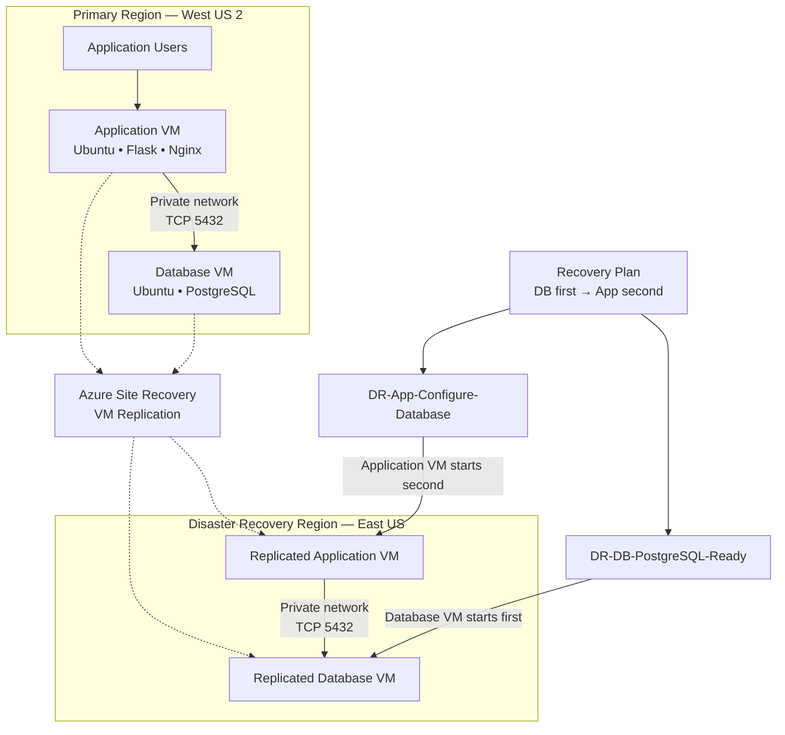

# Azure Cross-Region Disaster Recovery with Azure Site Recovery and Automated Recovery Runbooks

A hands-on Microsoft Azure project demonstrating cross-region disaster recovery for a two-tier web application using **Azure Site Recovery (ASR), Recovery Plans, and Azure Automation Runbooks**.

The project replicates an application VM and a PostgreSQL database VM from West US 2 to East US, orchestrates recovery in the correct order, and automates application database reconfiguration during recovery.

## Table of Contents

* [Project Overview](#project-overview)
* [Objectives](#objectives)
* [Architecture](#architecture)
* [Technology Stack](#technology-stack)
* [Azure Infrastructure](#azure-infrastructure)
* [Application Architecture](#application-architecture)
* [Disaster Recovery Workflow](#disaster-recovery-workflow)
* [Automation Runbooks](#automation-runbooks)
* [Testing and Validation](#testing-and-validation)
* [Security Considerations](#security-considerations)
* [Cost Considerations](#cost-considerations)
* [Project Scope and Limitations](#project-scope-and-limitations)
* [Future Enhancements](#future-enhancements)

## Project Overview

Disaster recovery is essential for maintaining application availability when infrastructure or an entire Azure region becomes unavailable.

In this project, I built a lab environment that demonstrates how an Azure-hosted application can recover in a secondary region using Azure Site Recovery and automated recovery procedures.

The solution consists of two virtual machines:

* **Application VM:** Runs a Python Flask web application behind Nginx.
* **Database VM:** Hosts a PostgreSQL database containing application data.

Azure Site Recovery replicates both virtual machines to the secondary region. An Azure Site Recovery Recovery Plan coordinates the recovery sequence, while Azure Automation Runbooks validate PostgreSQL readiness and reconfigure the application to connect to the database's active private IP address.

The project was implemented and validated through the Azure Portal and Azure Automation.

## Objectives

* Configure cross-region replication between West US 2 and East US.
* Build a two-tier application with separate application and database virtual machines.
* Configure a Recovery Services vault and Azure Site Recovery.
* Automate database-first, application-second recovery orchestration.
* Use Azure Automation Managed Identity and Azure RBAC for runbook access.
* Automate application database configuration after recovery.
* Validate application and database connectivity during recovery.
* Perform test failover, cleanup, failover, failback, and reprotection workflows.

## Architecture

### High-Level Architecture

*The diagram represents the logical recovery design. Replicated VMs are recovery copies managed by Azure Site Recovery, not two simultaneously active application stacks.*

### Regional Design

| Component          | Primary environment | Disaster recovery environment |
| ------------------ | ------------------- | ----------------------------- |
| Azure region       | West US 2           | East US                       |
| Resource group     | `rg-dr-primary`     | `rg-dr-eastus`                |
| Virtual network    | `vnet-dr-primary`   | `vnet-dr-eastus`              |
| VNet address space | `10.10.0.0/16`      | `10.20.0.0/16`                |
| Application subnet | `10.10.1.0/24`      | `10.20.1.0/24`                |
| Database subnet    | `10.10.2.0/24`      | `10.20.2.0/24`                |
| Application VM     | `dr-app-vm`         | ASR-managed recovery instance |
| Database VM        | `dr-db-vm`          | ASR-managed recovery instance |

The regional VNets use separate address spaces to support network isolation and cross-region recovery. A dedicated, non-overlapping test VNet was also created for test failover validation.

## Technology Stack

| Technology                              | Purpose                                       |
| --------------------------------------- | --------------------------------------------- |
| Microsoft Azure                         | Cloud infrastructure                          |
| Azure Virtual Machines                  | Application and database hosting              |
| Azure Site Recovery                     | Cross-region VM replication and recovery      |
| Recovery Services vault                 | Site Recovery management                      |
| Azure Site Recovery Recovery Plans      | Ordered recovery orchestration                |
| Azure Automation                        | Automated post-recovery operations            |
| Managed Identity and Azure RBAC         | Authentication and authorization for runbooks |
| Ubuntu Linux                            | Virtual machine operating system              |
| Python Flask                            | Web application                               |
| Nginx                                   | HTTP reverse proxy                            |
| PostgreSQL                              | Relational database                           |
| PowerShell and Azure PowerShell modules | Automation runbook implementation             |

## Azure Infrastructure

### 1. Networking

The project uses separate application and database subnets in each regional VNet.

The application VM communicates with PostgreSQL over the private network using TCP port 5432. Network Security Groups control traffic between the application, database, and permitted management endpoints.

NAT gateways provide outbound connectivity for the subnets that require it, without requiring a public IP address on the database VM.

### 2. Virtual Machines

Two Ubuntu Linux virtual machines form the application stack:

* `dr-app-vm` hosts the web application.
* `dr-db-vm` hosts PostgreSQL.

The database VM does not require a public IP address for application-to-database communication.

### 3. Azure Site Recovery

Azure Site Recovery was configured to replicate the primary virtual machines to East US.

The implementation included:

* Configuring the Recovery Services vault.
* Enabling replication for both VMs.
* Resolving Linux replication prerequisites and compatibility issues.
* Verifying replication health and recovery points.
* Performing test failover and cleanup.
* Performing failover, commit, reprotection, failback, and subsequent reprotection.

The final validation confirmed that both replicated items were **Protected**, replication health was **Healthy**, and the latest RPO information was available in the Azure portal.

## Application Architecture

### Application Tier

The application VM runs a Python Flask web application behind Nginx.

Nginx accepts HTTP traffic and forwards requests to the Flask service listening on `127.0.0.1:5000`.

The application reads its PostgreSQL connection configuration from `/etc/dr-app.env`.

The database host is controlled by the `DB_HOST` environment variable, allowing the application to connect to the database's private IP address in the active recovery environment.

### Database Tier

The database VM runs PostgreSQL and hosts the `dr_demo` database.

The database contains an `employees` table used to demonstrate database connectivity and application functionality.

The sample dataset contains five employee records.

### Application Validation

The application was validated through its HTTP endpoint. The page confirmed:

* Database status: Connected.
* Employee records successfully retrieved from PostgreSQL.
* Application functionality working after recovery and database reconfiguration.

## Disaster Recovery Workflow

The Recovery Plan is named `rp-dr-app-stack`.

It uses two recovery groups to ensure that the database tier is started before the application tier.

| Recovery group | Virtual machine | Configured action                        |
| -------------- | --------------- | ---------------------------------------- |
| Group 1        | `dr-db-vm`      | Post-action: `DR-DB-PostgreSQL-Ready`    |
| Group 2        | `dr-app-vm`     | Post-action: `DR-App-Configure-Database` |

The recovery sequence is:

1. Azure Site Recovery recovers the database VM in the secondary region.
2. The database readiness runbook verifies PostgreSQL service availability and the expected employee record count.
3. Azure Site Recovery recovers the application VM.
4. The application configuration runbook discovers the database VM's private IP address.
5. The runbook updates `DB_HOST` in `/etc/dr-app.env` and restarts the Flask service.
6. The runbook waits for the application to become available and validates database connectivity.

This sequence reduces the risk of the application starting with an outdated database IP address or before the database service is ready.

## Automation Runbooks

### `DR-DB-PostgreSQL-Ready`

**Purpose:** Validate that PostgreSQL is ready after the database VM starts.

The runbook:

* Authenticates using the Automation Account's system-assigned Managed Identity.
* Discovers the database VM and its current resource group.
* Executes a Linux command through Azure VM Run Command.
* Checks the PostgreSQL service status.
* Queries the `employees` table to verify that the expected five records are available.
* Reports success or failure based on the validation results.

### `DR-App-Configure-Database`

**Purpose:** Reconfigure and validate the Flask application after recovery.

The runbook:

* Authenticates using Managed Identity.
* Discovers the database and application VMs.
* Identifies the database VM's private IP address from its network interface.
* Updates the application's `DB_HOST` configuration.
* Restarts the Flask application service.
* Waits for the application to become healthy.
* Validates that the application responds and confirms database connectivity.

### Automation Security

The Automation Account uses a system-assigned Managed Identity with the required Virtual Machine Contributor role assignments at the primary and DR resource-group scopes.

This allows the runbooks to authenticate to Azure and invoke VM Run Command without storing an Azure service-principal secret in the runbook code.

## Testing and Validation

The project was validated using the following recovery and application checks.

| Test                                                    | Result                             |
| ------------------------------------------------------- | ---------------------------------- |
| Primary application and PostgreSQL connectivity         | Successful                         |
| Azure Site Recovery replication health                  | Healthy for both VMs               |
| Database readiness runbook                              | Successful                         |
| Application configuration runbook                       | Successful                         |
| Recovery Plan database-first ordering                   | Configured and validated           |
| Test failover to an isolated, non-overlapping test VNet | Successful                         |
| Runbook execution during Recovery Plan test failover    | Successful                         |
| Test failover cleanup                                   | Successful                         |
| Actual failover and recovery commit                     | Completed                          |
| Reprotection and failback workflow                      | Completed                          |
| Final replication verification                          | Protected and Healthy for both VMs |

The successful test failover demonstrated that the Recovery Plan and its post-actions could execute in an isolated recovery environment. The application was also validated after database configuration was corrected for the active region.

These results establish functional lab validation of the implemented recovery workflow. They do not constitute a formal production-scale performance or business-continuity assessment.

## Security Considerations

* Keep database access on private networking and restrict inbound database traffic to authorized sources.
* Use Managed Identity and least-privilege RBAC for Azure automation.
* Do not commit database passwords, SSH private keys, connection strings containing secrets, or other credentials to GitHub.
* Review VM Run Command output and logs before publishing them, as command output can contain sensitive information.
* Review network rules, public IP exposure, and access permissions before using a similar design in a production environment.

## Cost Considerations

This project was built as a learning lab with cost awareness in mind.

Potential Azure charges include:

* Running virtual machines and their managed disks.
* Azure Site Recovery replication and related storage.
* Storage transactions and recovery points.
* Public IP addresses and NAT gateway resources.
* Azure Monitor, Log Analytics, and other optional services.

The actual cost depends on VM sizes, disk capacity, region-specific pricing, replication activity, and resource retention.

After testing, review the remaining resources and remove only those that are no longer needed. Preserve the primary and DR infrastructure if you intend to continue using the lab.

## Project Scope and Limitations

This implementation focuses on **Level 1 functional disaster recovery validation**.

The completed scope includes cross-region VM replication, Recovery Plan orchestration, automated post-recovery configuration, test failover, cleanup, and validation of application-to-database connectivity.

The project does not currently claim:

* Measured or guaranteed RTO/RPO compliance against business requirements.
* Production-scale load or performance testing.
* Independent database backup and restore validation.
* Formal high-availability or business-continuity certification.
* Complete production-grade DNS, traffic-routing, monitoring, or security hardening.

These are possible future enhancements rather than prerequisites for documenting the completed lab.

## Future Enhancements

Possible future improvements include:

* Defining and measuring recovery time and recovery point objectives.
* Implementing independent PostgreSQL backup and restore validation.
* Integrating Key Vault for application secrets.
* Adding comprehensive monitoring, alerting, and runbook failure diagnostics.
* Automating client access and DNS changes during recovery.
* Performing workload-based capacity and performance testing.
* Expanding the automation and infrastructure deployment process.

## Conclusion

This project demonstrates a practical Azure cross-region disaster recovery workflow using Azure Site Recovery, Recovery Plans, and Azure Automation Runbooks.

It combines infrastructure replication with application-aware recovery checks, automated database endpoint discovery, and post-recovery application validation.

The project strengthened my practical understanding of Azure Site Recovery, Linux VM recovery, networking, PostgreSQL connectivity, managed identity, Azure RBAC, and recovery orchestration.

**Repository:** `azure-disaster-recovery-setup`
